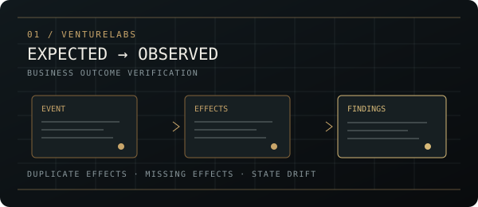
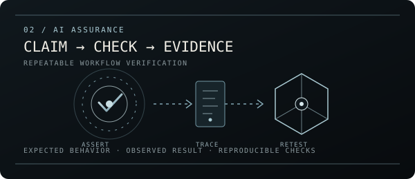
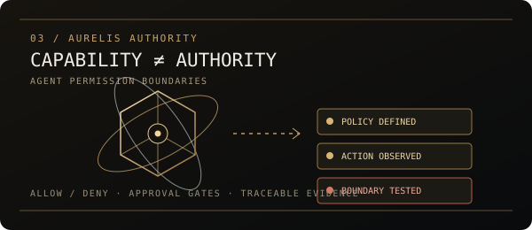
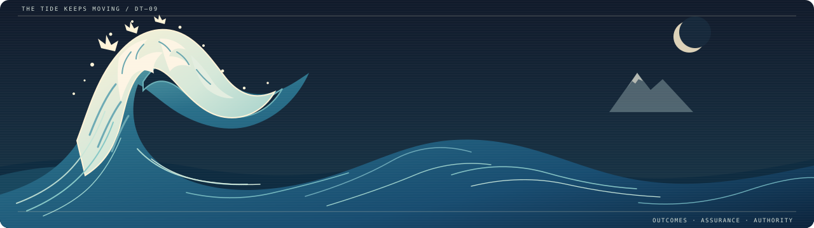

<!-- DT-09 / THE VERIFICATION ATLAS -->

  

  INDEPENDENT BUILDER &nbsp; / &nbsp; AI SYSTEMS &nbsp; / &nbsp; SOFTWARE INFRASTRUCTURE

 

<table>
<tr>
<td width="62%" valign="top">
  OPERATING THESIS / 001
  <h2>Capability is easy to demo. Reliability is harder to prove.</h2>
  I build practical software and test systems around a recurring question: <i>what actually happened, what was supposed to happen, and can we verify the difference?</i>
</td>
<td width="38%" valign="top">
  THE THREAD CONNECTING MY WORK  
  <code>EXPECTED</code> → <code>OBSERVED</code>  
  <code>BOUNDARY</code> → <code>TEST</code>  
  <code>RESULT</code> → <code>EVIDENCE</code>
</td>
</tr>
</table>

---

## / 01 — The workbench

THREE SYSTEMS. THREE DIFFERENT FAILURE SURFACES.

<table>
<tr>
<td width="33%" valign="top">
  
  <h3>01 / VentureLabs</h3>
  OUTCOME CHECK · BUSINESS WORKFLOW VERIFICATION
  
Checks whether events produce the expected business effects and resulting state. Designed to flag duplicate, missing, unexpected, or inconsistent outcomes.

  
<code>CSV / JSONL</code> <code>CLI</code> <code>GITHUB ACTION</code>

  <a href="https://venturelabs.pages.dev/">OPEN PRODUCT ↗</a> · <a href="https://github.com/DT-09/VentureLabs">SOURCE ↗</a>
    ENGINEERING PROTOTYPE · SYNTHETIC FIXTURES · NOT CUSTOMER-VALIDATED
</td>
<td width="33%" valign="top">
  
  <h3>02 / AI Assurance</h3>
  ASSURANCE INFRASTRUCTURE
  
Prototyping repeatable checks for AI-enabled workflows: explicit expectations, observable behavior, traceable findings, and regression-oriented verification.

  
<code>TEST HARNESS</code> <code>TRACEABILITY</code> <code>RETESTING</code>

  <a href="https://github.com/DT-09/ai-assurance-infrastructure">EXPLORE REPOSITORY ↗</a>
    FOCUS: MAKE ASSURANCE CLAIMS TESTABLE
</td>
<td width="34%" valign="top">
  
  <h3>03 / Aurelis Authority</h3>
  AI AGENT AUTHORITY ASSURANCE
  
Explores independent checks on whether an AI agent stays within defined permissions, approval gates, and action boundaries—not merely whether it can perform an action.

  
<code>ALLOW / DENY</code> <code>POLICY</code> <code>EVIDENCE</code>

  <a href="https://github.com/DT-09/Aurelis-Authority">EXPLORE REPOSITORY ↗</a>
    CORE QUESTION: WAS THIS ACTION AUTHORIZED?
</td>
</tr>
</table>

  VENTURELABS VERIFIES OUTCOMES &nbsp; ◇ &nbsp; AI ASSURANCE VERIFIES WORKFLOWS &nbsp; ◇ &nbsp; AURELIS AUTHORITY VERIFIES PERMISSIONS

---

## / 02 — Tools in the stack

  
    
  <code>PROTOTYPING</code> &nbsp; <code>API INTEGRATION</code> &nbsp; <code>TESTING</code> &nbsp; <code>DEPLOYMENT</code>

---

## / 03 — Contribution terrain

  
  3D contribution visualization generated through GitHub Actions.

## / 04 — Activity signals

  
  

---

  <a href="https://github.com/DT-09">GITHUB</a> &nbsp;·&nbsp;
  <a href="https://www.linkedin.com/in/dhairy-topia/">LINKEDIN</a> &nbsp;·&nbsp;
  <a href="mailto:dhairytopia@gmail.com">EMAIL</a>
    
  BUILD WITH INTENT / VERIFY THE BOUNDARIES / SHOW THE EVIDENCE

 

  

