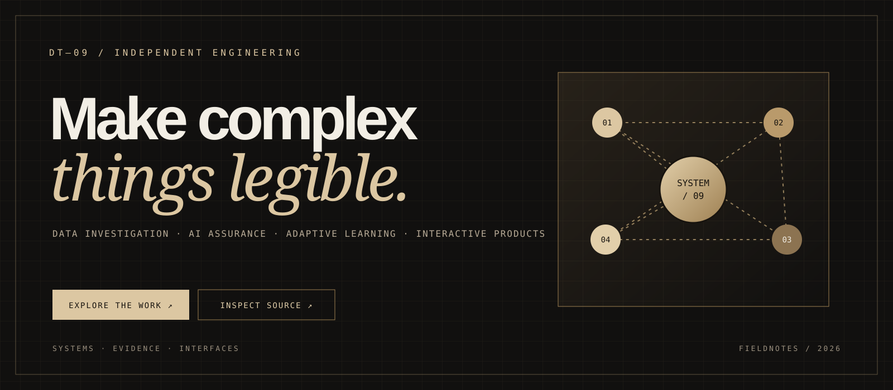

<!--
DT—09 / Profile fieldbook
Visual language: midnight ink · ultraviolet · signal-lime · warm paper
-->

  
    
  
  
  

 

# DT—09 / Engineering Fieldbook

**I build software for problems that deserve more than a dashboard.**

Data investigation. AI assurance. Adaptive learning. Interactive products.

My work centres on a recurring engineering question:

> What happened, why did it happen, and what evidence lets someone verify the answer?

The [interactive fieldbook](https://dt-09.github.io/DT-09/) is the full experience: project explorer, visual system maps, an interactive evidence pipeline, and direct routes into the code.

---

## The work

<table>
  <tr>
    <td width="50%" valign="top">
      <h3>01 / LedgerTrace</h3>
      
      
Investigates supplier invoices against purchase orders and goods receipts. Surfaces rule-triggered exceptions with source-row evidence for human review.

      DATA INVESTIGATION · DETERMINISTIC RULES · EVIDENCE 
      <a href="https://github.com/DT-09/LedgerTrace">Source ↗</a>
    </td>
    <td width="50%" valign="top">
      <h3>02 / Aurelis Authority</h3>
      
      
Assesses AI-agent tool calls against defined authority policies. Compares expected and observed decisions and preserves trace evidence.

      AI ASSURANCE · POLICY CHECKS · TRACE REVIEW 
      <a href="https://github.com/DT-09/Aurelis-Authority">Source ↗</a>
    </td>
  </tr>
  <tr>
    <td valign="top">
      <h3>03 / AI Assurance Infrastructure</h3>
      
Foundations for AI asset identity, authority, evidence provenance, policy decisions, trust state and runtime control.

      PROTOCOL DESIGN · POLICY EVALUATION 
      <a href="https://github.com/DT-09/ai-assurance-infrastructure">Source ↗</a>
    </td>
    <td valign="top">
      <h3>04 / AI Evaluation Evidence Validator</h3>
      
Evaluates AI outputs against versioned acceptance protocols, hard gates and case-level outcomes, with human adjudication.

      AI EVALUATION · ACCEPTANCE TESTING 
      <a href="https://github.com/DT-09/AI-Evaluation-Evidence-Validator">Source ↗</a>
    </td>
  </tr>
  <tr>
    <td valign="top">
      <h3>05 / LUMEN ALS</h3>
      
A source-grounded adaptive learning platform connecting indexed material, tutoring, practice, progress estimates and an interactive concept graph.

      ADAPTIVE LEARNING · RETRIEVAL · CONCEPT GRAPH 
      <a href="https://github.com/DT-09/lumen-als">Source ↗</a>
    </td>
    <td valign="top">
      <h3>06 / AUREL Desktop</h3>
      
A native Windows companion with a translucent desktop widget, system indicators, configurable themes and a cursor-scheme utility.

      WINDOWS · C# · .NET 
      <a href="https://github.com/DT-09/AurelDesktop">Source ↗</a>
    </td>
  </tr>
  <tr>
    <td valign="top">
      <h3>07 / IL ROSSO</h3>
      
An editorial experience combining a 3D concept-car study, a historical archive and a guided interface.

      INTERACTIVE 3D · THREE.JS · MOTION 
      <a href="https://github.com/DT-09/IL-ROSSO">Source ↗</a>
    </td>
    <td valign="top">
      <h3>08 / VentureLabs</h3>
      
      
A browser workspace for explicit assumptions, evidence records, experiments and decision reports.

      VENTURE VALIDATION · EXPERIMENT DESIGN 
      <a href="https://github.com/DT-09/VentureLabs">Source ↗</a>
    </td>
  </tr>
</table>

---

## One engineering pattern

`INPUTS → RULES → OBSERVATION → EVIDENCE → HUMAN DECISION`

Different domains. One consistent preference for explicit inputs, observable behaviour, traceable findings and honest limitations.

| Discipline | What I build with |
|---|---|
| Application engineering | Python · JavaScript · TypeScript · C# · React · FastAPI · .NET |
| Data and decision systems | CSV / JSON pipelines · deterministic validation · SQLite · REST APIs |
| AI assurance | Policy evaluation · acceptance protocols · trace auditing · regression testing |
| Interactive interfaces | Responsive workflows · data visualisation · Three.js · motion |
| Delivery | Git · GitHub Actions · Cloudflare Pages |

Technologies are listed because they appear in the work above—not as a claim of equal depth or production experience in every tool.

## Engineering standards

- **Evidence before assertion.** Keep source references and calculation paths close to results.
- **Deterministic where possible.** Make important checks repeatable.
- **Boundaries are part of the design.** State what a tool does not establish.
- **Human review stays visible.** Surface uncertainty and escalation points.
- **Demonstrate the real system.** Prefer runnable examples, tests and inspectable outputs to decorative claims.

---

### Continue into the work

[LinkedIn](https://www.linkedin.com/in/dhairy-topia/) · [GitHub](https://github.com/DT-09)

DT—09 / INDEPENDENT ENGINEERING · SYSTEMS · EVIDENCE · INTERFACES

