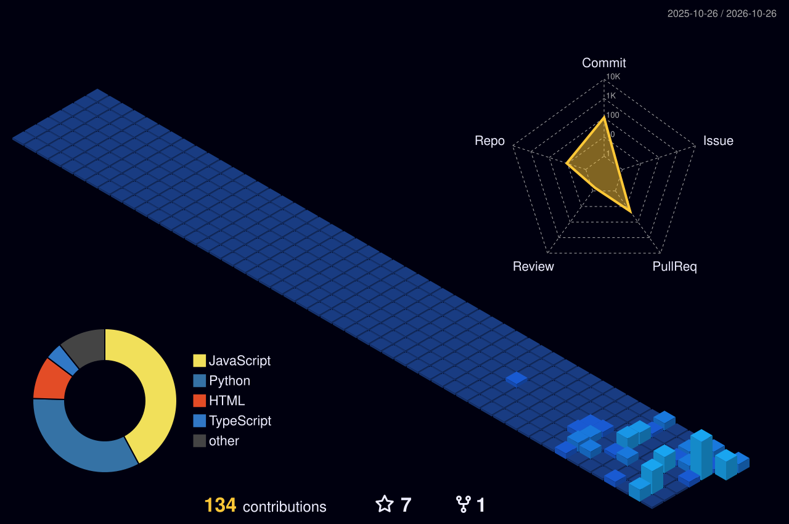

<!-- DT-09 / PROFILE README — editorial systems aesthetic -->

  

  
  
  

 

<table>
  <tr>
    <td width="58%" valign="top">
      FIELD NOTE / 001
      <h2>Intelligence is impressive. Control is harder.</h2>
      I build software and explore AI systems with a focus on the gap between what an agent <i>can</i> do and what it should be allowed to do.
        
      That means boundaries you can test, failures you can reproduce, and evidence you can inspect—not trust-me demos.
    </td>
    <td width="42%" valign="top">
      OPERATING PRINCIPLES  
      <b>01 / Make it testable</b> Turn assumptions into explicit checks.  
      <b>02 / Make it inspectable</b> Keep expected and observed behavior visible.  
      <b>03 / Make it honest</b> A prototype is not production readiness.
    </td>
  </tr>
</table>

---

## 01 / Systems on the workbench

<table>
  <tr>
    <td width="50%" valign="top">
      <a href="https://github.com/DT-09/Aurelis-Authority"><b>AURELIS AUTHORITY ↗</b></a> 
      AI AGENT ASSURANCE  
      Exploring independent checks on whether AI-agent actions stay within defined authority boundaries.  
      <code>POLICY</code> <code>EXPECTED VS OBSERVED</code> <code>EVIDENCE</code>
    </td>
    <td width="50%" valign="top">
      <a href="https://github.com/DT-09/ai-assurance-infrastructure"><b>AI ASSURANCE INFRASTRUCTURE ↗</b></a> 
      CONTROL PLANE / VERIFICATION  
      Prototypes for assurance controls, regression checks, audit evidence, and retesting of AI-enabled workflows.  
      <code>TESTING</code> <code>TRACEABILITY</code> <code>RETESTING</code>
    </td>
  </tr>
  <tr>
    <td width="50%" valign="top">
      <a href="https://github.com/DT-09/aurelis-aci"><b>AURELIS ACI ↗</b></a> 
      AGENT CONTROL INTERFACE  
      Exploring how agent behavior and constraints can be made easier to inspect through clear control surfaces.  
      <code>INTERFACES</code> <code>WORKFLOWS</code> <code>CONTROL</code>
    </td>
    <td width="50%" valign="top">
      <b>VentureLabs / experiments</b> 
      PRODUCT SYSTEMS  
      Building and testing practical software ideas. The aim is to solve a real workflow problem—not add another dashboard to the internet.  
      <code>PROTOTYPING</code> <code>DATA</code> <code>VALIDATION</code>
    </td>
  </tr>
</table>

## 02 / Tools, not trophies

  
    
  Prototyping · API integration · testing and debugging · deployment workflows

## 03 / Contribution terrain

  

The 3D contribution terrain refreshes through GitHub Actions. If the image is missing on first setup, run the workflow once from the Actions tab.

## 04 / Activity signals

  
  

  

---

  <a href="https://github.com/DT-09">GITHUB</a> &nbsp;·&nbsp;
  <a href="https://www.linkedin.com/in/dhairy-topia/">LINKEDIN</a> &nbsp;·&nbsp;
  <a href="mailto:dhairytopia@gmail.com">EMAIL</a>
    
  BUILD WITH INTENT / VERIFY THE BOUNDARIES / SHOW THE EVIDENCE

