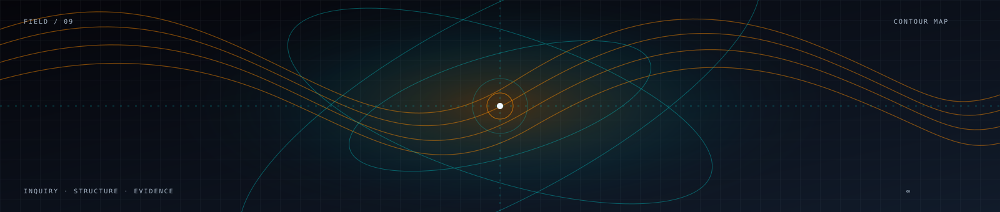
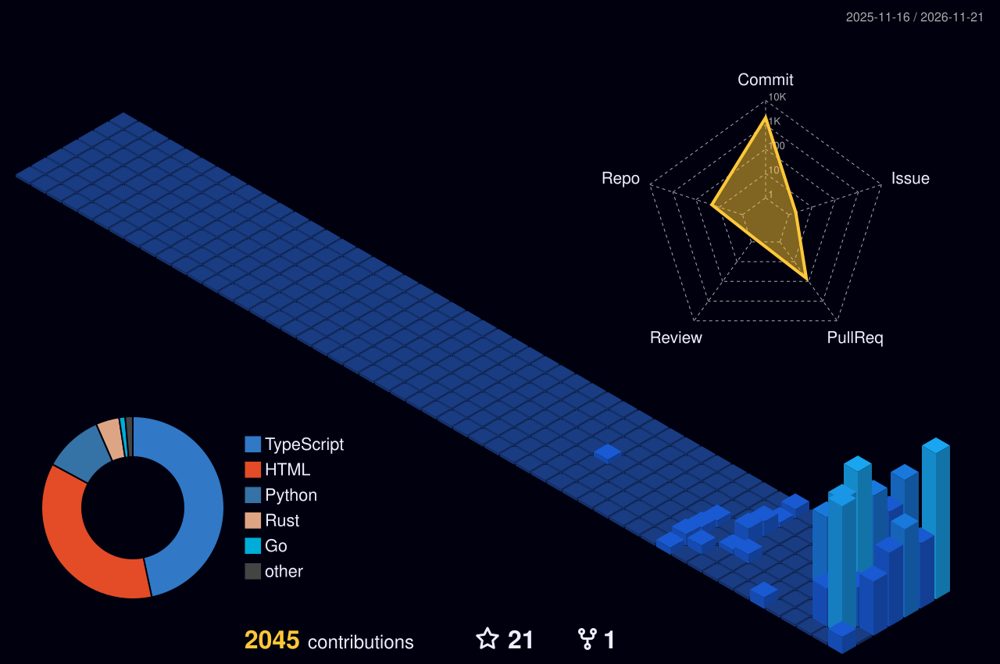

A GOOD PLACE TO BEGIN IS WITH A QUESTION.

— Carl Sagan

---

## The work, at a glance

I study difficult problems, build computational systems, and look for ways to make complex ideas testable.

| EXPLORE | ENGINEER | ESTABLISH |
|:--|:--|:--|
| Mathematics & logic | Algorithms & runtimes | Tests & invariants |
| Scientific questions | Software & data systems | Evidence & provenance |
| Models & abstractions | Tools & infrastructure | Reproducible results |

**Current direction:** move between theory and implementation—from understanding the structure of a problem to building a system that can be inspected, challenged and improved.

## 01 / Selected systems

*Different projects. Different questions. One consistent standard: make the mechanism understandable.*

| PROJECT | FIELD | WHAT IT EXPLORES |
|---|---|---|
| [**NODUS**](https://github.com/DT-09/Nodus) | Commerce intelligence | Merchant economics, order performance and operational signals |
| [**AI Assurance Infrastructure**](https://github.com/DT-09/ai-assurance-infrastructure) | AI governance | Boundaries, evaluation and auditability for AI systems |
| [**ORTHEON**](https://github.com/DT-09/Ortheon) | Structural computation | Graphs, hypergraphs and relational structures |
| [**VANTAGE**](https://github.com/DT-09/Vantage) | Workflow systems | Deterministic execution, recovery and inspection |
| [**STRATA**](https://github.com/DT-09/Strata) | Data engineering | Local analytical workflows and reproducible exploration |
| [**LOTWISE**](https://github.com/DT-09/Lotwise) | Quality intelligence | Supplier evidence and specification comparison |
| [**DealTie**](https://github.com/DT-09/DealTie) | Financial evidence | Traceable reconciliation of transaction records |
| [**PHANTOM**](https://github.com/DT-09/Phantom) | Low-level systems | Constrained x86-64 assembly and packet structures |
| [**Migraven**](https://github.com/DT-09/Migraven) | Migration verification | Precise comparison and verification of migrated data |

**Further explorations:** [Vesper](https://github.com/DT-09/Vesper) · [CommitmentGraph](https://github.com/DT-09/CommitmentGraph) · [DatasheetDelta](https://github.com/DT-09/DatasheetDelta) · [Aurelis Authority](https://github.com/DT-09/Aurelis-Authority) · [All repositories ↗](https://github.com/DT-09?tab=repositories)

Projects are at different stages of maturity. A concept, prototype, research implementation and production system are not interchangeable. Visit each repository for its current implementation, tests and limitations.

## 02 / Contribution topology

**A 3D view of public GitHub contribution activity over time.** It is a record of activity—not a proxy for code quality.

GENERATED CONTRIBUTION FIELD · UPDATED BY GITHUB ACTIONS

## 03 / Technical toolkit

*A growing toolkit across programming languages, systems, data, infrastructure and verification. Listed technologies reflect a mix of active use, study and exploration; proficiency is not uniform.*

### Languages & low-level foundations

x86-64 Assembly · Bash · PowerShell · SQL · HTML · CSS · SCSS · Markdown · LaTeX · WebAssembly

### Frameworks, runtimes & application development

### Databases, data & infrastructure

DuckDB · Data modelling · ETL concepts · Data lineage · Provenance · Local-first systems

### Cloud, delivery & developer environment

Cargo · CMake · CI/CD · Linux shell · Deployment workflows · API integration

### Engineering methods

| DISCIPLINE | TOOLKIT |
|---|---|
| **Mathematics** | Discrete mathematics · logic · probability · linear algebra · calculus · numerical methods |
| **Algorithms** | Data structures · graph algorithms · search · optimisation · complexity analysis |
| **Systems** | Memory & process fundamentals · concurrency · networking · operating systems |
| **AI engineering** | Model integration · agent architecture · tool boundaries · evaluation · assurance |
| **Formal reasoning** | Specification · invariants · proof-oriented reasoning · introductory formal verification |
| **Data engineering** | SQL · data modelling · transformation · lineage · integrity checks |
| **Verification** | Unit & integration tests · property-oriented testing · deterministic replay · hashing · audit trails |

## 04 / How I approach a problem

**QUESTION**　→　**MODEL**　→　**IMPLEMENT**　→　**TEST**　→　**REFINE**

| MOVE | PRACTICE |
|:--:|---|
| **01** | Find the actual problem. Separate facts from assumptions. |
| **02** | Define inputs, outputs, constraints and invariants. |
| **03** | Build the smallest complete mechanism that tests the model. |
| **04** | Challenge it with edge cases, failures and counterexamples. |
| **05** | Keep the evidence. Revise what the evidence disproves. |

## 05 / Questions on the horizon

<table>
<tr>
<td width="50%" valign="top">

**MATHEMATICAL STRUCTURE**

What representation makes a difficult problem simpler?

</td>
<td width="50%" valign="top">

**AI ASSURANCE**

How can an intelligent system's authority be bounded and audited?

</td>
</tr>
<tr>
<td width="50%" valign="top">

**CAUSAL COMPUTATION**

How can concurrent execution become explainable and reproducible?

</td>
<td width="50%" valign="top">

**DATA INTEGRITY**

Can every conclusion be traced to its source and transformations?

</td>
</tr>
<tr>
<td width="50%" valign="top">

**RESILIENT SYSTEMS**

How should software behave under uncertainty and constrained resources?

</td>
<td width="50%" valign="top">

**SCIENTIFIC LEARNING**

How does curiosity become a hypothesis, experiment and better model?

</td>
</tr>
</table>

## 06 / Principles

- **Mechanism over metaphor.**
- **Evidence over adjectives.**
- **Explicit boundaries over unchecked autonomy.**
- **Clarity over ornament.**
- **Curiosity disciplined by verification.**

[Research programme](RESEARCH.md) · [Portfolio evidence standard](PORTFOLIO_STANDARD.md) · [Browse repositories](https://github.com/DT-09?tab=repositories)

---

### THE UNKNOWN IS WORTH THE WORK.

DT—09 · INDEPENDENT INQUIRY / COMPUTATIONAL SYSTEMS

