 

 

<code>SOFTWARE SYSTEMS</code> &nbsp;·&nbsp; <code>APPLIED AI</code> &nbsp;·&nbsp; <code>DATA INTEGRITY</code> &nbsp;·&nbsp; <code>INTERACTIVE ENGINEERING</code>

  

&nbsp;

---

## / 01 — The signal

I build software products and technical systems across applied AI, verification, data workflows and interactive experiences.

The aim is practical: turn difficult requirements into working systems with observable behaviour, traceable evidence and clear limits.

**Operating principles**

`Explicit assumptions` &nbsp;·&nbsp; `Traceable evidence` &nbsp;·&nbsp; `Reproducible checks` &nbsp;·&nbsp; `Useful outcomes`

---

## / 02 — Selected work

A portfolio of experiments and products spanning operational software, AI assurance, data verification and interactive engineering.

<table>
<tr>
<td width="33%" valign="top">

### 01 / LedgerTrace

**Supplier-payment evidence review**

Compares supplier invoices with purchase orders and goods receipts. Surfaces potential discrepancies with source-row evidence for human review.

[Explore repository ↗](https://github.com/DT-09/LedgerTrace)

</td>
<td width="33%" valign="top">

### 02 / PaceLab

**Source-grounded learning environment**

An interactive learning product for concept exploration, source-linked tutoring, retrieval practice, spaced review and a focused maths studio.

[Explore repository ↗](https://github.com/DT-09/PaceLab)

</td>
<td width="33%" valign="top">

### 03 / Aurelis Outcome Assurance

**Independent AI outcome verification**

Checks whether an agent's claimed outcome is supported by its execution trace, including required actions, ordering, identity consistency, final state and evidence.

[Explore repository ↗](https://github.com/DT-09/aurelis-aoa)

</td>
</tr>
<tr>
<td width="33%" valign="top">

### 04 / Aurelis Authority

**Agent authority assurance**

Tests agent tool calls against defined authority policies and compares expected decisions with observed behaviour and trace evidence.

[Explore repository ↗](https://github.com/DT-09/Aurelis-Authority)

</td>
<td width="33%" valign="top">

### 05 / DealTie

**AI acceptance assurance workbench**

Evaluates third-party AI outputs against buyer-defined, versioned acceptance protocols. Records case outcomes, hard gates, human adjudication and portable evidence packages.

[Explore repository ↗](https://github.com/DT-09/DealTie)

</td>
<td width="33%" valign="top">

### 06 / Verity

**C17 migration verification**

A local-first CSV verification utility. Matches records by a unique key, compares selected fields and produces machine-readable findings with source-row references.

[Explore repository ↗](https://github.com/DT-09/Verity)

</td>
</tr>
<tr>
<td width="33%" valign="top">

### 07 / AUREL Desktop

**Native Windows companion**

A desktop utility with a translucent widget, system indicators, configurable themes and cursor-scheme utility.

[Explore repository ↗](https://github.com/DT-09/AurelDesktop)

</td>
<td width="33%" valign="top">

### 08 / IL ROSSO

**Automotive editorial experience**

An editorial interface combining a 3D concept-car study, historical archive and guided exploration.

[Explore repository ↗](https://github.com/DT-09/IL-ROSSO)

</td>
<td width="33%" valign="top">

### 09 / VentureLabs

**Experiment and decision workspace**

A browser workspace for explicit assumptions, an evidence ledger, pre-registered experiments and decision reports.

[Explore repository ↗](https://github.com/DT-09/VentureLabs)

</td>
</tr>
</table>

---

## / 03 — Technical range

**LANGUAGES**

  

**FRAMEWORKS · RUNTIMES · ENGINEERING**

**Also used:** SQL · FastAPI · CMake · pytest · npm · Cloudflare D1 · Pages · Workers · Wrangler · CSV · JSON · REST APIs

Selected tools shown above; additional technologies vary by project.

---

## / 04 — Git topography

A contribution year rendered as isometric terrain. Each raised cell represents a day; elevation reflects the daily contribution count.

Generated from the public GitHub contribution calendar and refreshed daily.

---

## / 05 — Engineering doctrine

| PRINCIPLE | APPLICATION |
|:--|:--|
| Evidence before assertion | Make claims inspectable. |
| Determinism where possible | Prefer reproducible checks to vague confidence. |
| Separation of concerns | Keep observation distinct from conclusion. |
| Human judgment where needed | Expose uncertainty; do not conceal it. |
| Honest limits | Never invent performance, customers or impact. |
| Purposeful interfaces | Make complex systems easier to understand. |

---

 

**QUASAR** &nbsp;·&nbsp; DT—09 / Independent engineering

[Explore all repositories ↗](https://github.com/DT-09?tab=repositories)

