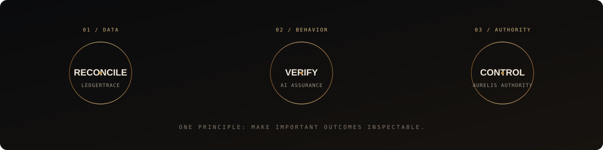

  

   

  

    <strong>AI SYSTEMS DEVELOPER</strong> &nbsp; / &nbsp;
    <strong>SOFTWARE INFRASTRUCTURE</strong> &nbsp; / &nbsp;
    <strong>INDEPENDENT BUILDER</strong>
  

  <h2>NOT JUST SOFTWARE THAT RUNS. SYSTEMS YOU CAN INSPECT.</h2>

  

    I build tools for business-data reconciliation, AI workflow verification, and agent authority boundaries.
     
    The common thread: <strong>turn hidden failure into visible evidence.</strong>
  

  

    <a href="https://github.com/DT-09/LedgerTrace">LEDGERTRACE</a> &nbsp;·&nbsp;
    <a href="https://github.com/DT-09/ai-assurance-infrastructure">AI ASSURANCE</a> &nbsp;·&nbsp;
    <a href="https://github.com/DT-09/Aurelis-Authority">AURELIS AUTHORITY</a>
  

  

    <a href="https://github.com/DT-09">GITHUB</a> &nbsp; / &nbsp;
    <a href="https://www.linkedin.com/in/dhairy-topia/">LINKEDIN</a> &nbsp; / &nbsp;
    <a href="mailto:dhairytopia@gmail.com">CONTACT</a>
  

---

  

## 01 — THE FLAGSHIP

# [LEDGERTRACE ↗](https://github.com/DT-09/LedgerTrace)

**RECONCILIATION, BUILT AROUND EVIDENCE.**

Business records rarely fail in dramatic ways. They drift: a price differs, a record is missing, a duplicate slips through, a credit does not line up. The expensive part is finding the discrepancy and proving what happened.

LedgerTrace is being built to make that work more systematic.

<table>
<tr>
<td width="25%" valign="top">

**01 / COMPARE**

Bring related records into view.

</td>
<td width="25%" valign="top">

**02 / DETECT**

Surface mismatches, missing entries, and possible duplicates.

</td>
<td width="25%" valign="top">

**03 / TRACE**

Connect each finding to the records behind it.

</td>
<td width="25%" valign="top">

**04 / REVIEW**

Give a human the context to verify the result.

</td>
</tr>
</table>

[**OPEN THE REPOSITORY**](https://github.com/DT-09/LedgerTrace) &nbsp; · &nbsp; [**VIEW THE LIVE PRODUCT**](https://ledgertrace.pages.dev/)

---

## 02 — SYSTEMS IN THE WORKSHOP

<table>
<tr>
<td width="50%" valign="top">

<h3>01 / BUSINESS DATA</h3>

# [LedgerTrace](https://github.com/DT-09/LedgerTrace)

**RECONCILE. EXPLAIN. REVIEW.**

A reconciliation workbench for comparing invoice, purchase-order, and receipt data, with a focus on exceptions that can be traced to source records.

PRIMARY FOCUS

[EXPLORE ↗](https://github.com/DT-09/LedgerTrace)

</td>
<td width="50%" valign="top">

<h3>02 / AI WORKFLOWS</h3>

# [AI Assurance Infrastructure](https://github.com/DT-09/ai-assurance-infrastructure)

**SPECIFY. TEST. VERIFY.**

An infrastructure project exploring repeatable checks for AI-enabled workflows: expected versus observed behavior, traceable findings, and regression-oriented verification.

[EXPLORE ↗](https://github.com/DT-09/ai-assurance-infrastructure)

</td>
</tr>
<tr>
<td width="50%" valign="top">

<h3>03 / AGENT AUTHORITY</h3>

# [Aurelis Authority](https://github.com/DT-09/Aurelis-Authority)

**PERMISSIONS MUST MEAN SOMETHING.**

Explores whether AI agents stay within defined permissions, approval requirements, and action boundaries—and how violations can be observed and investigated.

[EXPLORE ↗](https://github.com/DT-09/Aurelis-Authority)

</td>
<td width="50%" valign="top">

<h3>04 / THE THROUGH-LINE</h3>

# Expected → Observed → Evidence

**NO BLACK BOX HAND-WAVING.**

Define what should happen. Measure what actually happened. Preserve enough context to understand the gap.

Different domains. One engineering instinct: make important outcomes inspectable.

</td>
</tr>
</table>

---

## 03 — HOW I THINK ABOUT ENGINEERING

<table>
<tr>
<td align="center" width="25%">

### DEFINE

Set the expected behavior.

</td>
<td align="center" width="25%">

### TEST

Observe the real outcome.

</td>
<td align="center" width="25%">

### TRACE

Keep the supporting evidence.

</td>
<td align="center" width="25%">

### IMPROVE

Validate the correction.

</td>
</tr>
</table>

I care about the layer between *“it seems to work”* and *“we can show that it worked.”* That means practical tooling, observable behavior, useful failure reports, and systems that help people make better decisions.

## 04 — TECHNICAL TOOLKIT

  
   
  PROTOTYPING · API INTEGRATION · TESTING · DATA VALIDATION · DEPLOYMENT

---

## 05 — THE SIGNAL

  
  &nbsp;
  
    
  

---

  <h2>BUILD WITH INTENT.</h2>
  <h3>MAKE THE RESULT VISIBLE.</h3>
  
<a href="https://github.com/DT-09/LedgerTrace">SEE WHAT I'M BUILDING ↗</a>

  DT—09 / SOFTWARE SYSTEMS IN PROGRESS

