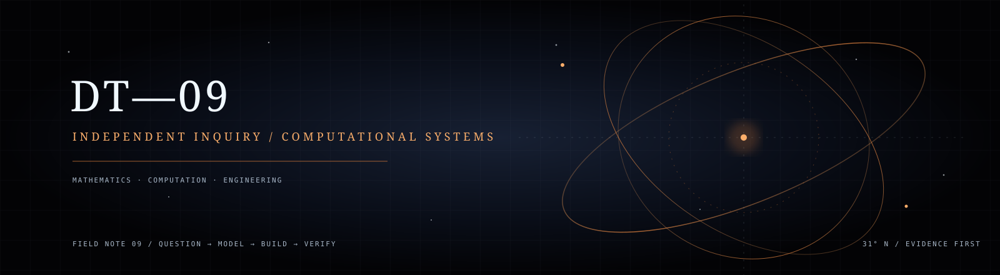
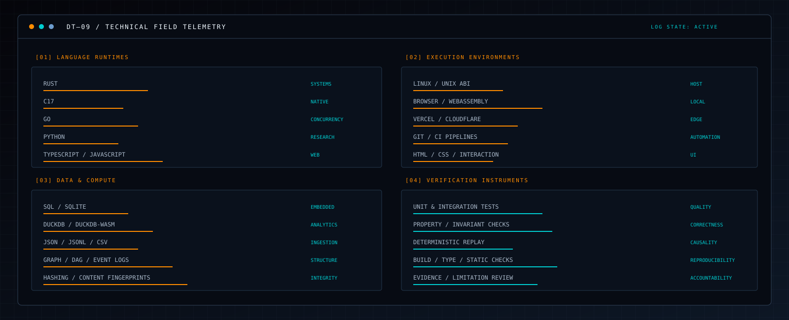

  

— Carl Sagan

  
  
  

---

## The person behind the repositories

I explore how difficult problems can be understood, modelled and turned into dependable systems.

<table>
<tr>
<td width="33%" valign="top">

**01 · THINK**

Mathematics · logic · algorithms · scientific reasoning

</td>
<td width="33%" valign="top">

**02 · ENGINEER**

Systems · runtimes · data · software architecture

</td>
<td width="33%" valign="top">

**03 · VERIFY**

Tests · invariants · provenance · reproducibility

</td>
</tr>
</table>

My work moves between low-level computation and higher-level systems: from algorithms and execution models to data integrity, AI assurance and research tools.

**The standard:** understand the mechanism, make assumptions explicit, test the result, and document what remains uncertain.

## 01 / Selected systems

Nine projects. Nine distinct engineering questions.

| SYSTEM | DOMAIN | THE QUESTION |
|---|---|---|
| [**NODUS**](https://github.com/DT-09/Nodus) | Commerce intelligence | Can merchants see the real economics behind orders, shipping and fulfilment? |
| [**AI Assurance Infrastructure**](https://github.com/DT-09/ai-assurance-infrastructure) | AI governance | How should intelligent systems be bounded, evaluated and audited? |
| [**ORTHEON**](https://github.com/DT-09/Ortheon) | Structural computation | How can graphs, hypergraphs and relations be represented and analysed? |
| [**VANTAGE**](https://github.com/DT-09/Vantage) | Workflow execution | Can a workflow remain deterministic, recoverable and inspectable? |
| [**STRATA**](https://github.com/DT-09/Strata) | Data engineering | Can analytical workflows stay local, visual and reproducible? |
| [**LOTWISE**](https://github.com/DT-09/Lotwise) | Quality intelligence | Can supplier evidence and specification differences be reviewed traceably? |
| [**DealTie**](https://github.com/DT-09/DealTie) | Financial evidence | Can transaction records be reconciled without losing their source context? |
| [**PHANTOM**](https://github.com/DT-09/Phantom) | Low-level systems | What can constrained x86-64 assembly reveal about packet structures? |
| [**Migraven**](https://github.com/DT-09/Migraven) | Migration verification | Can data migrations be compared with precise, reproducible evidence? |

**More explorations:** [Vesper](https://github.com/DT-09/Vesper) · [CommitmentGraph](https://github.com/DT-09/CommitmentGraph) · [DatasheetDelta](https://github.com/DT-09/DatasheetDelta) · [Aurelis Authority](https://github.com/DT-09/Aurelis-Authority) · [Browse all repositories](https://github.com/DT-09?tab=repositories)

Project maturity varies. A concept, prototype, research implementation and production system are different things. See each repository for current implementation, tests and limitations. No customer adoption, revenue, certification or benchmark superiority is implied.

## 02 / Contribution topology

**A three-dimensional record of work over time.**

GitHub contribution history · generated SVG · activity visualisation, not a measure of code quality

## 03 / Technical toolkit

A broad working toolkit across languages, runtimes, data systems and engineering methods. **Depth varies by technology**; inclusion indicates use, study or active exploration—not equal proficiency.

### Languages

**Also:** x86-64 Assembly · Bash · PowerShell · SQL · HTML · CSS · SCSS · Markdown · LaTeX · WebAssembly

### Frameworks, runtimes & interfaces

### Data, storage & infrastructure

### Cloud, delivery & developer tools

### Engineering disciplines

| DOMAIN | METHODS & TOOLS |
|---|---|
| **Algorithms** | Data structures · graph algorithms · search · optimisation · complexity · numerical methods |
| **Systems** | Memory and process fundamentals · concurrency · networking · operating systems · WebAssembly |
| **Data** | SQL · SQLite · PostgreSQL · DuckDB · ETL concepts · data modelling · provenance |
| **AI systems** | Model integration · agent architecture · tool boundaries · policy evaluation · assurance |
| **Mathematics** | Discrete mathematics · logic · probability · linear algebra · calculus · invariants |
| **Formal methods** | Proof-oriented reasoning · specification · introductory formal verification |
| **Build & delivery** | Cargo · CMake · Git · CI pipelines · Linux shell · deployment workflows |
| **Verification** | Unit and integration tests · property-oriented tests · deterministic replay · hashing · audit trails |

## 04 / Engineering field notes

- **Model the problem** — define inputs, outputs, constraints and invariants.
- **Expose the mechanism** — make state, execution and dependencies inspectable.
- **Preserve evidence** — retain provenance from source data to conclusion.
- **Design for failure** — test boundaries, recovery paths and unexpected inputs.
- **Verify the claim** — use tests, traces and reproducible results.

## 05 / Questions worth investigating

<table>
<tr>
<td width="50%" valign="top">

**MATHEMATICAL STRUCTURE**

Which representations reveal the hidden structure of a difficult problem?

</td>
<td width="50%" valign="top">

**AI ASSURANCE**

How can an intelligent system's authority be bounded and audited?

</td>
</tr>
<tr>
<td width="50%" valign="top">

**CAUSAL COMPUTATION**

What evidence makes concurrent execution explainable and reproducible?

</td>
<td width="50%" valign="top">

**DATA INTEGRITY**

Can every conclusion be traced to its source and transformations?

</td>
</tr>
<tr>
<td width="50%" valign="top">

**RESILIENT SYSTEMS**

How should software behave under uncertainty and constrained resources?

</td>
<td width="50%" valign="top">

**SCIENTIFIC LEARNING**

How does curiosity become a hypothesis, experiment and better model?

</td>
</tr>
</table>

## 06 / Working method

**QUESTION** &nbsp; ⟶ &nbsp; **MODEL** &nbsp; ⟶ &nbsp; **BUILD** &nbsp; ⟶ &nbsp; **TEST** &nbsp; ⟶ &nbsp; **REFINE**

| STEP | PRACTICE |
|:--:|---|
| **01** | Identify the real problem and challenge its assumptions. |
| **02** | Formalise the model, constraints and failure boundaries. |
| **03** | Build a complete mechanism that can be examined. |
| **04** | Test behaviour and preserve reproducible evidence. |
| **05** | Revise the design when results disagree with expectations. |

## 07 / Principles

- **Mechanism over metaphor.**
- **Evidence over adjectives.**
- **Explicit boundaries over unchecked autonomy.**
- **Clarity over ornament.**
- **Curiosity disciplined by verification.**

[Research programme](RESEARCH.md) · [Portfolio evidence standard](PORTFOLIO_STANDARD.md) · [All repositories](https://github.com/DT-09?tab=repositories)

---

### THE UNKNOWN IS WORTH THE WORK.

  

DT—09 · INDEPENDENT INQUIRY / COMPUTATIONAL SYSTEMS

