 

&nbsp;

  

APPLIED AI &nbsp;·&nbsp; SYSTEMS ENGINEERING &nbsp;·&nbsp; DATA & EVIDENCE &nbsp;·&nbsp; SOFTWARE & INTERACTIVE MEDIA

---

## 01 / The work

I build independent software across AI assurance, data integrity, financial workflows, engineering tools and interactive experiences.

The work moves between research and implementation: define the problem, make the system observable, test its behaviour, preserve the evidence and state its limits. Some projects are prototypes or early evaluation products; their status is documented in their repositories.

**A few recurring questions**

- How can an AI system be given clear authority—and how can its actions be checked?
- How can separate records be compared without losing their source context?
- How can complex technical information become easier to explore and reason about?
- How can software make uncertainty visible instead of hiding it?

---

## 02 / Selected work — nine projects

AI ASSURANCE &nbsp; / &nbsp; LEARNING &nbsp; / &nbsp; FINANCIAL EVIDENCE &nbsp; / &nbsp; ENGINEERING &nbsp; / &nbsp; INTERACTIVE DESIGN

<table>
<tr>
<td width="33%" valign="top">

### 01 — AI Assurance Infrastructure

**Vendor-neutral AI assurance and control plane**

Persistent identity, authority, evidence, policy, evaluation and runtime-control foundations, with a protocol and experimental benchmark.

[Repository ↗](https://github.com/DT-09/ai-assurance-infrastructure)

</td>
<td width="33%" valign="top">

### 02 — Aurelis Authority

**AI agent authority assessment**

Defines intended authority, evaluates supplied tool-call traces against policy, and produces expected-versus-observed findings for human review.

[Repository ↗](https://github.com/DT-09/Aurelis-Authority)

</td>
<td width="33%" valign="top">

### 03 — Vesper

**Adaptive discovery and learning**

An open-ended inquiry environment for exploring subjects, forming hypotheses, researching sources, testing ideas and deriving qualified answers.

[Repository ↗](https://github.com/DT-09/Vesper)

</td>
</tr>
<tr>
<td width="33%" valign="top">

### 04 — LedgerTrace

**Supplier-payment evidence review**

Connects invoice lines with purchase orders, goods receipts and supported payment or credit context. Turns rule-triggered differences into source-linked cases for finance review.

[Repository ↗](https://github.com/DT-09/LedgerTrace)

</td>
<td width="33%" valign="top">

### 05 — DealTie

**Financial evidence reconciliation**

A transaction-document workbench for comparing selected metrics across CIM, QoE and valuation materials, preserving source references and review findings.

[Repository ↗](https://github.com/DT-09/DealTie)

</td>
<td width="33%" valign="top">

### 06 — DatasheetDelta

**Engineering revision intelligence**

Compares supported fields across technical document revisions, normalises selected units and produces a provenance-linked change register.

[Repository ↗](https://github.com/DT-09/DatasheetDelta)

</td>
</tr>
<tr>
<td width="33%" valign="top">

### 07 — CommitmentGraph

**Evidence-led commitment intelligence**

Links obligations, dated events and source records into an inspectable graph. Runs deterministic investigations and exposes the evidence behind each finding.

[Repository ↗](https://github.com/DT-09/CommitmentGraph)

</td>
<td width="33%" valign="top">

### 08 — Migraven

**Migration export verification**

A local-first C17 utility for comparing CSV and flat JSONL exports by key, producing source-row findings and SHA-256 integrity manifests.

[Repository ↗](https://github.com/DT-09/Migraven)

</td>
<td width="33%" valign="top">

### 09 — IL ROSSO

**Interactive automotive experience**

An independent, fan-made Scuderia Ferrari tribute with an original 3D concept-car study, editorial storytelling and a navigable archive.

[Repository ↗](https://github.com/DT-09/IL-ROSSO)

</td>
</tr>
</table>

---

## 03 / Technical range

The projects span low-level utilities, application software, APIs, data processing, cloud deployment and real-time 3D experiences.

**LANGUAGES & WEB FOUNDATIONS**

  

**APPLICATIONS, FRAMEWORKS & RUNTIMES**

  

**CLOUD, BUILD, TEST & DELIVERY**

**Additional tools and formats**

- **Backend & APIs:** Python, FastAPI, Streamlit, REST, Node.js, Cloudflare Workers and Pages Functions.
- **Data & persistence:** SQL, SQLite, Cloudflare D1, CSV, JSON, JSONL, structured document extraction and SHA-256 evidence manifests.
- **Documents:** PDF text extraction, XLSX and XLS, DOCX, TXT and Markdown processing.
- **Frontend & 3D:** React, TypeScript, Vite, CSS, Three.js, React Three Fiber, Drei, Motion and GSAP.
- **Native & systems:** C17, CMake, command-line tooling, cross-platform build and packaging workflows.
- **Quality & delivery:** pytest, unittest, CTest, npm scripts, GitHub Actions, Docker and Cloudflare deployment workflows.

*Tools are listed because they appear in project implementations or documented workflows—not as a claim of equal depth across every technology.*

---

## 04 / How I approach engineering

| PRINCIPLE | IN PRACTICE |
|:--|:--|
| Evidence before assertion | Keep claims connected to inspectable source material. |
| Explicit boundaries | State what the system does, does not do and cannot establish. |
| Determinism where useful | Prefer reproducible rules for checks that need consistent outcomes. |
| Traceability | Preserve source references, inputs, versions and outputs. |
| Human judgment | Surface exceptions and uncertainty; leave consequential decisions reviewable. |
| Testable design | Build around observable behaviour, validation and clear failure states. |
| Useful complexity | Make the underlying system rigorous without making the interface needlessly difficult. |

---

## 05 / Git topography

A visual rendering of the public contribution calendar. Activity is not a measure of project quality.

---

### Wonder is where knowing begins.

DT—09 &nbsp;·&nbsp; INDEPENDENT SOFTWARE & SYSTEMS ENGINEERING

 

<a href="https://github.com/DT-09?tab=repositories">EXPLORE ALL REPOSITORIES ↗</a>

  

