 

<a href="#selected-work">SELECTED WORK</a> &nbsp;·&nbsp;
<a href="#the-field">THE FIELD</a> &nbsp;·&nbsp;
<a href="#working-method">METHOD</a> &nbsp;·&nbsp;
<a href="#technical-range">TECHNICAL RANGE</a> &nbsp;·&nbsp;
<a href="https://github.com/DT-09?tab=repositories">REPOSITORIES ↗</a>

---

<table>
<tr>
<td width="62%" valign="top">

## A mind for questions. A discipline for systems.

I work where **mathematics, computation, applied AI and systems engineering** meet.

The interest is not technology for its own sake. It is the structure beneath a problem: the assumptions that shape it, the logic that governs it, and the evidence that tells us whether a solution works.

I move between abstract inquiry and practical construction. A question may begin as a mathematical model, become an algorithm, and end as a tool that someone can inspect and use.

</td>
<td width="38%" valign="middle" align="center">

OPERATING PRINCIPLE

  

**MAKE THE INVISIBLE**

*explicit.*

**MAKE THE COMPLEX**

*inspectable.*

**MAKE THE RESULT**

*verifiable.*

</td>
</tr>
</table>

## The field

The disciplines are not separate lanes. They form a feedback system. Mathematics sharpens the model; computation tests it; design makes it usable; evidence challenges the result. The next question often comes from the last answer.

| Domain | The questions |
|---|---|
| **Mathematics & computation** | What structure is hidden in a problem? Which abstractions make it tractable? |
| **AI & authority** | How should intelligent systems act, and how can their actions be bounded and evaluated? |
| **Data & provenance** | Can every important conclusion be traced to its source, transformation and assumptions? |
| **Systems engineering** | What makes software reproducible, resilient, observable and dependable? |
| **Learning & discovery** | How can people move from curiosity to independent investigation? |

## Selected work

Independent projects across assurance, data, finance, learning and interactive systems. The repositories hold the implementation, documentation and current status; descriptions here are concise orientation, not claims of completion.

<table>
<tr>
<td width="50%" valign="top">

01 / AI ASSURANCE

### [AI Assurance Infrastructure ↗](https://github.com/DT-09/ai-assurance-infrastructure)

Foundations for evaluating AI systems through identity, authority, evidence, policy and testing.

</td>
<td width="50%" valign="top">

02 / AGENT AUTHORITY

### [Aurelis Authority ↗](https://github.com/DT-09/Aurelis-Authority)

Explores how agent actions can be checked against intended permissions and policy.

</td>
</tr>
<tr>
<td width="50%" valign="top">

03 / LEARNING SYSTEMS

### [Vesper ↗](https://github.com/DT-09/Vesper)

An inquiry-led learning environment connecting questions, hypotheses, research and investigation.

</td>
<td width="50%" valign="top">

04 / FINANCIAL EVIDENCE

### [Caseweft ↗](https://github.com/DT-09/LedgerTrace)

A local-first AP exception evidence workbench that turns supported invoice, PO and receipt exports into reviewable, source-linked cases.

</td>
</tr>
<tr>
<td width="50%" valign="top">

05 / TRANSACTION ANALYSIS

### [DealTie ↗](https://github.com/DT-09/DealTie)

A transaction-document workbench for structured review of selected financial and deal materials.

</td>
<td width="50%" valign="top">

06 / ENGINEERING DATA

### [DatasheetDelta ↗](https://github.com/DT-09/DatasheetDelta)

Engineering revision intelligence: compares supported technical-document fields and produces a provenance-linked change register for human review.

</td>
</tr>
<tr>
<td width="50%" valign="top">

07 / COMMITMENT INTELLIGENCE

### [CommitmentGraph ↗](https://github.com/DT-09/CommitmentGraph)

An evidence-oriented approach to connecting obligations, events and source records.

</td>
<td width="50%" valign="top">

08 / DATA MIGRATION

### [Migraven ↗](https://github.com/DT-09/Migraven)

A local-first C17 utility for comparing CSV and flat JSONL exports by key, with source-row findings and SHA-256 manifests.

</td>
</tr>
<tr>
<td width="50%" valign="top">

09 / INTERACTIVE DESIGN

### [IL ROSSO ↗](https://github.com/DT-09/IL-ROSSO)

An independent automotive concept study combining 3D exploration and editorial interaction.

</td>
<td width="50%" valign="top">

THE COMPLETE INDEX

### [All repositories ↗](https://github.com/DT-09?tab=repositories)

The wider record: experiments, active builds, research and supporting work.

</td>
</tr>
</table>

## Working method

The loop is deliberate, not ceremonial:

- **Inquire.** Define the problem before choosing the tool.
- **Model.** State assumptions, constraints, inputs and expected behaviour.
- **Build.** Implement a coherent mechanism, not a decorative demonstration.
- **Verify.** Test the result against explicit expectations and source evidence.
- **Review.** Record what failed, what remains uncertain and what should change.

A working result is not automatically a reliable result. Verification is part of the product.

## Technical range

Tools and languages represented across the repositories. This is a map of the working environment, not a claim of equal expertise in every item.

<strong>Languages & systems</strong>

C17 · C++ · C# · Python · JavaScript · TypeScript · Bash · SQL · HTML · CSS

<strong>Applications & interfaces</strong>

React · Vite · Three.js · React Three Fiber · FastAPI · Node.js · .NET · Cloudflare Workers · Cloudflare Pages

<strong>Data, testing & delivery</strong>

SQLite · Cloudflare D1 · CSV · JSON · JSONL · PDF/XLSX/DOCX processing · SHA-256 · pytest · unittest · CTest · CMake · Git · GitHub Actions · Docker

## Principles

| | |
|---|---|
| **Traceability** | Important outputs should retain a path to their inputs and evidence. |
| **Explicitness** | Assumptions, permissions, constraints and limitations belong in the open. |
| **Reproducibility** | A process should be repeatable and its result inspectable. |
| **Restraint** | Complexity must justify its cost. More features do not make a better system. |
| **Human judgment** | Automation should support review, not conceal uncertainty. |
| **Correction** | Tests, criticism and failure are evidence. Use them. |

---

**Curiosity sets the direction. Precision shapes the work. Evidence tests the claim.**

 

<a href="https://github.com/DT-09?tab=repositories">EXPLORE THE WORK ↗</a>

  

DT—09 &nbsp;·&nbsp; INDEPENDENT SYSTEMS ENGINEERING

