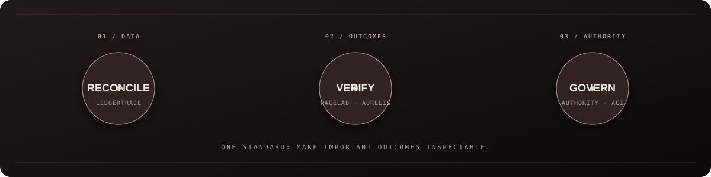
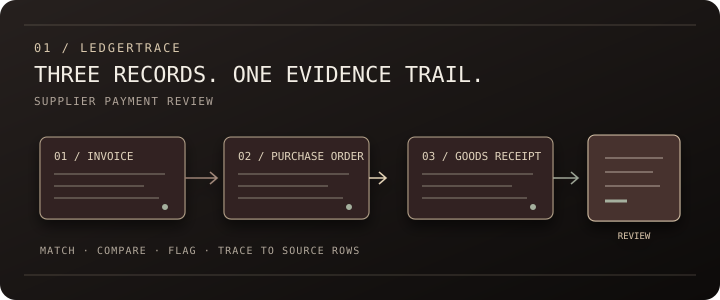
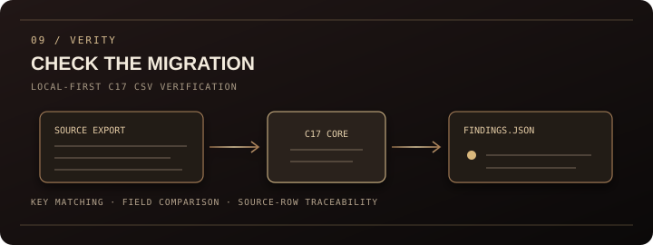
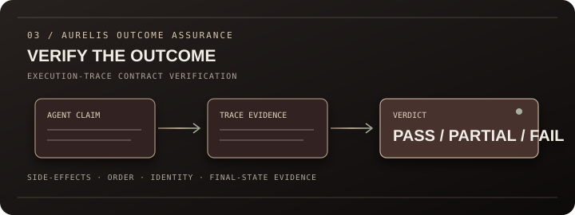
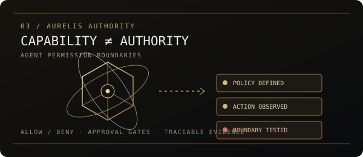
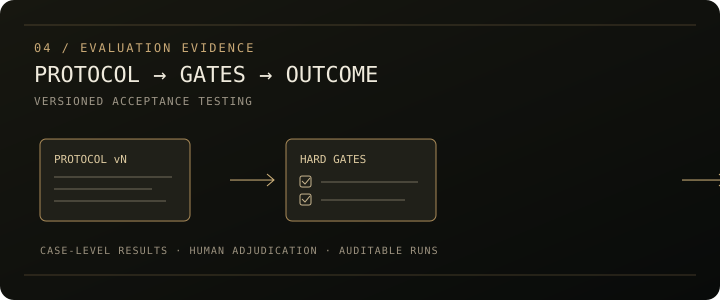
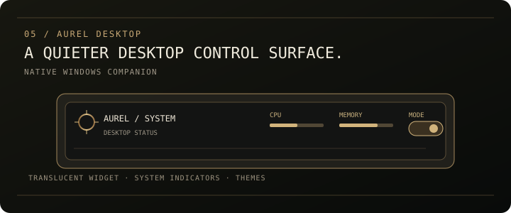
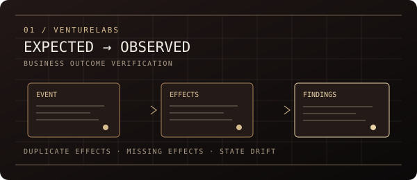

 

**SOFTWARE ENGINEERING** &nbsp;·&nbsp; **AI SYSTEMS** &nbsp;·&nbsp; **DATA & EVIDENCE** &nbsp;·&nbsp; **INFRASTRUCTURE**

---

## Engineering, with intent.

I build systems that turn complex inputs into inspectable outcomes: software products, verification tools, data workflows and AI control infrastructure.

**The standard:** explicit assumptions, traceable evidence, reproducible checks and honest limits.

---

## Selected work

Ten selected projects across product engineering, verification, AI assurance and interactive systems. The showcase favours concrete capabilities over a long list of repository names.

<table>
<tr>
<td width="50%" valign="top">

### 01 / LedgerTrace

**Supplier-payment evidence review**

Compares supplier invoices with purchase orders and goods receipts. Produces source-linked potential discrepancies for human review.

[Repository ↗](https://github.com/DT-09/LedgerTrace)

</td>
<td width="50%" valign="top">

### 02 / PaceLab

**Source-grounded learning environment**

An interactive learning product with source-linked tutoring, concept exploration, retrieval practice, spaced review and a constrained maths studio.

[Repository ↗](https://github.com/DT-09/PaceLab)

</td>
</tr>
<tr>
<td width="50%" valign="top">

### 03 / Verity

**C17 migration verification utility**

A local-first tool for comparing agreed source and target CSV exports. Checks keys and selected fields, then reports mismatches with source-row references. Early MVP; not production-certified.

[Repository ↗](https://github.com/DT-09/Verity)

</td>
<td width="50%" valign="top">

### 04 / Aurelis Outcome Assurance

**Independent AI outcome verification**

Checks whether an agent's claimed business outcome is supported by its execution trace: required actions, duplicates, ordering, identity consistency, final state and evidence.

[Repository ↗](https://github.com/DT-09/aurelis-aoa)

</td>
</tr>
<tr>
<td width="50%" valign="top">

### 05 / Aurelis Authority

**Agent authority assurance**

Tests agent tool calls against defined authority policies. Compares expected and observed decisions with trace evidence.

[Repository ↗](https://github.com/DT-09/Aurelis-Authority)

</td>
<td width="50%" valign="top">

### 06 / Aurelis Infrastructure

**AI control and assurance infrastructure**

A family of systems covering AI identity, policy, authority, change and release assurance, evidence and operational control.

[AI Assurance Infrastructure ↗](https://github.com/DT-09/ai-assurance-infrastructure) · [ACI ↗](https://github.com/DT-09/aurelis-aci) · [AAI ↗](https://github.com/DT-09/aurelis-aai)

</td>
</tr>
<tr>
<td width="50%" valign="top">

### 07 / AI Evaluation Evidence Validator

**Versioned evaluation protocols**

Evaluates AI outputs against acceptance protocols, hard gates and case-level outcomes, with human adjudication.

[Repository ↗](https://github.com/DT-09/AI-Evaluation-Evidence-Validator)

</td>
<td width="50%" valign="top">

### 08 / AUREL Desktop

**Native Windows companion**

A desktop utility with a translucent widget, system indicators, configurable themes and cursor-scheme utility.

[Repository ↗](https://github.com/DT-09/AurelDesktop)

</td>
</tr>
<tr>
<td width="50%" valign="top">

### 09 / IL ROSSO

**Automotive editorial experience**

An editorial interface combining a 3D concept-car study, historical archive and guided exploration.

[Repository ↗](https://github.com/DT-09/IL-ROSSO)

</td>
<td width="50%" valign="top">

### 10 / VentureLabs

**Experiment and decision workspace**

A browser workspace for explicit assumptions, an evidence ledger, pre-registered experiments and decision reports.

[Repository ↗](https://github.com/DT-09/VentureLabs)

</td>
</tr>
</table>

---

## The workbench / technical toolkit

A practical toolkit across systems programming, application engineering, data handling, interface work and deployment.

| Layer | Languages and tools |
|---|---|
| **Programming languages** | C / C17 · C# · Python · JavaScript · TypeScript · HTML · CSS · SQL |
| **Application frameworks** | FastAPI · React · .NET · Three.js |
| **Data and interfaces** | SQLite · Cloudflare D1 · CSV · JSON · REST APIs |
| **Build and testing** | CMake · pytest · npm · Docker |
| **Versioning and delivery** | Git · GitHub Actions · Cloudflare Pages · Cloudflare Workers · Wrangler |

Toolkit reflects technologies used across the listed repositories; depth and production maturity vary by project.

---

## Git topography

A three-dimensional view of contribution activity. Each raised cell represents a day; elevation scales with the number of GitHub contributions.

Generated by GitHub Actions from the public contribution calendar. The first automated run replaces the initial placeholder; subsequent refreshes run daily.

---

## Repository pulse

Live public repository metadata and latest commit activity. Updated automatically by GitHub Actions.

<!-- PROFILE_PULSE:START -->
_The live repository pulse is waiting for its first workflow refresh._
<!-- PROFILE_PULSE:END -->

---

## Engineering principles

- Evidence before assertion.
- Deterministic checks where possible.
- Observation kept separate from conclusion.
- Human review where judgment is required.
- Clear limits; no invented performance or customer claims.
- Interfaces should clarify the system, not decorate it.

---

**[Browse all repositories ↗](https://github.com/DT-09?tab=repositories)**

