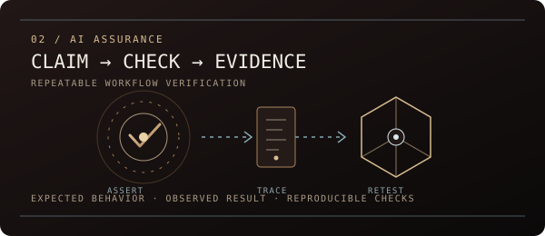

 

**SYSTEMS ENGINEERING** &nbsp;·&nbsp; **AI ASSURANCE** &nbsp;·&nbsp; **DATA INVESTIGATION** &nbsp;·&nbsp; **INTERACTIVE SOFTWARE**

---

## A practice of making complexity legible.

I build software around problems that need structure, evidence and clear decisions.

**The through-line:** make inputs explicit, logic inspectable, outcomes traceable and limitations visible.

---

## Selected work

A collection of independent projects across evidence systems, AI controls, evaluation infrastructure and interface engineering.

<table>
<tr>
<td width="50%" valign="top">

### 01 — LedgerTrace

**Supplier-payment evidence review**

Compares supplier invoices with purchase orders and goods receipts. Surfaces potential discrepancies with source-row evidence for human review.

[Explore repository ↗](https://github.com/DT-09/LedgerTrace)

</td>
<td width="50%" valign="top">

### 02 — Aurelis Authority

**AI agent authority assurance**

Tests agent tool calls against defined authority policies. Compares expected and observed decisions with trace evidence.

[Explore repository ↗](https://github.com/DT-09/Aurelis-Authority)

</td>
</tr>
<tr>
<td width="50%" valign="top">

### 03 — AI Assurance Infrastructure

**Identity · authority · provenance**

Explores infrastructure for AI asset identity, authority, evidence provenance, policy decisions, trust state and runtime control.

[Explore repository ↗](https://github.com/DT-09/ai-assurance-infrastructure)

</td>
<td width="50%" valign="top">

### 04 — AI Evaluation Evidence Validator

**Versioned evaluation protocols**

Evaluates AI outputs against acceptance protocols, hard gates and case-level outcomes, with human adjudication.

[Explore repository ↗](https://github.com/DT-09/AI-Evaluation-Evidence-Validator)

</td>
</tr>
<tr>
<td width="50%" valign="top">

### 05 — AUREL Desktop

**Native Windows experience**

A desktop companion with a translucent widget, system indicators, configurable themes and cursor-scheme utility.

[Explore repository ↗](https://github.com/DT-09/AurelDesktop)

</td>
<td width="50%" valign="top">

### 06 — IL ROSSO

**Automotive editorial experience**

An editorial interface combining a 3D concept-car study, historical archive and guided exploration.

[Explore repository ↗](https://github.com/DT-09/IL-ROSSO)

</td>
</tr>
<tr>
<td width="50%" valign="top">

### 07 — VentureLabs

**Experiment and decision workspace**

A browser workspace for explicit assumptions, an evidence ledger, pre-registered experiments and decision reports.

[Explore repository ↗](https://github.com/DT-09/VentureLabs)

</td>
<td width="50%" valign="top">

### Engineering principles

- Evidence before assertion.
- Deterministic checks where possible.
- Observation kept separate from conclusion.
- Human review where judgment is required.
- No capability claims without proof.

**Design intent**

Quiet interfaces. Clear hierarchy. Useful motion. Technical detail with a reason to exist.

</td>
</tr>
</table>

---

## How I approach engineering

**INPUT** &nbsp; → &nbsp; **RULES** &nbsp; → &nbsp; **OBSERVATION** &nbsp; → &nbsp; **EVIDENCE** &nbsp; → &nbsp; **DECISION**

Build the path. Preserve the context. Make the result inspectable.

| Domain | Working range |
|---|---|
| Application engineering | Python · JavaScript · TypeScript · C# · React · FastAPI · .NET |
| Data systems | CSV / JSON pipelines · deterministic validation · SQLite · REST APIs |
| AI assurance | Policy evaluation · acceptance protocols · trace auditing · regression testing |
| Interfaces | Responsive workflows · interactive visualisation · Three.js · motion |
| Delivery | Git · GitHub Actions · Cloudflare Pages · CI workflows |

Technologies listed reflect tools used across projects; depth varies by implementation.

---

**[Browse all repositories ↗](https://github.com/DT-09?tab=repositories)**

