 

<a href="#selected-work">WORK</a> &nbsp;·&nbsp;
<a href="#questions-i-follow">QUESTIONS</a> &nbsp;·&nbsp;
<a href="#how-i-work">METHOD</a> &nbsp;·&nbsp;
<a href="#technical-range">TECHNICAL RANGE</a> &nbsp;·&nbsp;
<a href="https://github.com/DT-09?tab=repositories">ALL REPOSITORIES ↗</a>

---

<table>
<tr>
<td width="64%" valign="top">

### INDEPENDENT INQUIRY / SYSTEMS ENGINEERING

# A mind for questions. A discipline for systems.

I work across **mathematics, computation, applied AI and systems engineering**.

I am interested in what sits beneath the interface: the model that frames a problem, the logic that moves it forward, and the evidence that tells us whether the result deserves trust.

The work moves between theory and implementation. An idea should survive contact with constraints. A system should make its behaviour inspectable. A claim should have somewhere solid to stand.

</td>
<td width="36%" valign="middle">

DESIGN TEST

**01 — CLARITY**

Can the problem be stated precisely?

 

**02 — MECHANISM**

Can the solution be explained?

 

**03 — EVIDENCE**

Can the result be checked?

 

**04 — LIMITS**

Is uncertainty visible?

</td>
</tr>
</table>

## Questions I follow

| Field | The question underneath |
|---|---|
| **Mathematics & computation** | What structure is hidden in the problem? Which abstractions make it tractable? |
| **Models & algorithms** | What assumptions are encoded, and what follows from them? |
| **AI & authority** | How should intelligent systems act, and how can those actions be bounded and evaluated? |
| **Data & provenance** | Can a conclusion be traced through its sources and transformations? |
| **Systems engineering** | What makes a system reproducible, resilient and observable? |
| **Learning & discovery** | How do we move from curiosity to independent investigation? |

These are connected disciplines, not separate interests. Mathematics sharpens the model; computation tests it; design makes it usable; evidence challenges the result.

## Selected work

A selection of repositories across assurance, data, finance, learning and interactive systems. Each link leads to its source: implementation, documentation and current state. The descriptions are orientation, not claims that every project is complete.

<table>
<tr>
<td width="50%" valign="top">

01 / AI ASSURANCE

### [AI Assurance Infrastructure ↗](https://github.com/DT-09/ai-assurance-infrastructure)

Foundations for evaluating AI systems through identity, authority, evidence, policy and testing.

</td>
<td width="50%" valign="top">

02 / AGENT AUTHORITY

### [Aurelis Authority ↗](https://github.com/DT-09/Aurelis-Authority)

Explores how agent actions can be checked against intended permissions and policy.

</td>
</tr>
<tr>
<td width="50%" valign="top">

03 / LEARNING SYSTEMS

### [Vesper ↗](https://github.com/DT-09/Vesper)

An inquiry-led learning environment connecting questions, hypotheses, research and investigation.

</td>
<td width="50%" valign="top">

04 / FINANCIAL EVIDENCE

### [Caseweft ↗](https://github.com/DT-09/LedgerTrace)

A local-first AP exception evidence workbench that turns supported invoice, PO and receipt exports into reviewable, source-linked cases.

</td>
</tr>
<tr>
<td width="50%" valign="top">

05 / TRANSACTION ANALYSIS

### [DealTie ↗](https://github.com/DT-09/DealTie)

A transaction-document workbench for structured review of selected financial and deal materials.

</td>
<td width="50%" valign="top">

06 / ENGINEERING DATA

### [DatasheetDelta ↗](https://github.com/DT-09/DatasheetDelta)

Compares supported technical-document fields and produces a provenance-linked change register for human review.

</td>
</tr>
<tr>
<td width="50%" valign="top">

07 / COMMITMENT INTELLIGENCE

### [CommitmentGraph ↗](https://github.com/DT-09/CommitmentGraph)

An evidence-oriented approach to connecting obligations, events and source records.

</td>
<td width="50%" valign="top">

08 / DATA MIGRATION

### [Migraven ↗](https://github.com/DT-09/Migraven)

A local-first C17 utility for comparing CSV and flat JSONL exports by key, with source-row findings and SHA-256 manifests.

</td>
</tr>
<tr>
<td width="50%" valign="top">

09 / INTERACTIVE DESIGN

### [IL ROSSO ↗](https://github.com/DT-09/IL-ROSSO)

An independent automotive concept study combining 3D exploration and editorial interaction.

</td>
<td width="50%" valign="top">

THE WIDER RECORD

### [All repositories ↗](https://github.com/DT-09?tab=repositories)

Experiments, active builds, research and supporting work beyond this selection.

</td>
</tr>
</table>

## How I work

**Inquire.** Define the problem before choosing the tool.

**Model.** State assumptions, constraints, inputs and expected behaviour.

**Build.** Implement the mechanism. Avoid mistaking a convincing interface for a working system.

**Verify.** Test against explicit expectations and source evidence.

**Review.** Record failures, uncertainty and the next correction.

The process is iterative. Verification is not the final ceremony; it changes what gets built next.

## Technical range

<strong>Languages & systems</strong>

C17 · C++ · C# · Python · JavaScript · TypeScript · Bash · SQL · HTML · CSS

<strong>Applications & interfaces</strong>

React · Vite · Three.js · React Three Fiber · FastAPI · Node.js · .NET · Cloudflare Workers · Cloudflare Pages

<strong>Data, testing & delivery</strong>

SQLite · Cloudflare D1 · CSV · JSON · JSONL · PDF/XLSX/DOCX processing · SHA-256 · pytest · unittest · CTest · CMake · Git · GitHub Actions · Docker

Tools listed here appear across the repositories; the list does not imply equal depth or production use in every technology.

## Principles

<table>
<tr><td width="22%"><strong>Traceability</strong></td><td>Important outputs retain a path to their inputs and evidence.</td></tr>
<tr><td><strong>Explicitness</strong></td><td>Assumptions, permissions, constraints and limitations stay visible.</td></tr>
<tr><td><strong>Reproducibility</strong></td><td>A process should be repeatable and its result inspectable.</td></tr>
<tr><td><strong>Restraint</strong></td><td>Complexity must justify its cost. More features do not make a better system.</td></tr>
<tr><td><strong>Human judgment</strong></td><td>Automation should support review, not conceal uncertainty.</td></tr>
<tr><td><strong>Correction</strong></td><td>Tests, criticism and failure are evidence. Use them.</td></tr>
</table>

---

**Curiosity sets the direction. Precision shapes the work. Evidence tests the claim.**

 

<a href="https://github.com/DT-09?tab=repositories">EXPLORE THE WORK ↗</a>

  

DT—09 &nbsp;·&nbsp; INDEPENDENT SYSTEMS ENGINEERING

